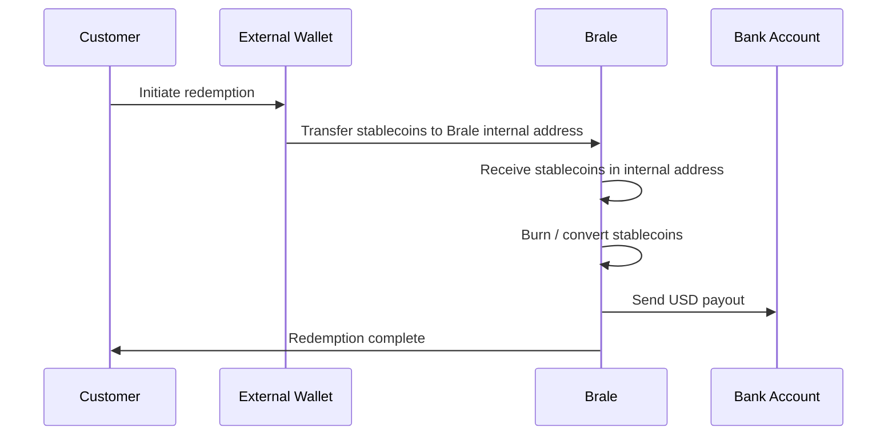

In order to submit a stablecoin-to-fiat transaction, first you need to:

- Create an [Account](/key-concepts/accounts) representing your customer
- Create an [Address](/key-concepts/addresses) which is your customer's bank account where Brale will deposit USD
- Deposit stablecoins to a Brale custodial address (address with type `internal`)

<Warning>
**Important** — Brale can only off-ramp stablecoins that are already held in a Brale internal address.
If stablecoins are currently in an external or self-custody wallet, they must first be transferred to a Brale internal address before you submit the fiat payout request.
</Warning>

## Link an Address to your customer's Account

Destination bank addresses can be created in two ways:

- **Plaid-linked bank account** — Securely connect a bank account via the Plaid Link SDK. Supports `ach_debit`, `ach_credit`, and `rtp_credit`.
- **Direct bank entry** — Submit bank details directly via the Addresses API. Supports `wire`, `ach_credit`, `same_day_ach_credit`, `rtp_credit`, and `fednow_credit`.

| Capability   | Plaid-linked bank account | Direct bank entry |
| ------------ | ------------------------- | ----------------- |
| `ach_debit`  | Supported                 | Not supported     |
| `ach_credit` | Supported                 | Supported         |
| `rtp_credit` | Supported                 | Supported         |
| `fednow_credit` | Supported              | Supported         |
| `wire`       | Not supported             | Supported         |

**Direct bank entry** is the right path when you already have bank account details or need `wire` transfers. For the full comparison and guidance, see [External bank addresses](/key-concepts/external-bank-addresses).

### Direct bank entry

Here is an example of adding an ACH/RTP offchain address via Direct bank entry using [Create a new external address](/api-reference/brale/create-address).

**POST** `https://api.brale.xyz/accounts/account_id/addresses/external`

<Note>
For Direct bank entry addresses without `wire` (ACH, RTP, or FedNow only), `bank_address` and `beneficiary_address` are optional. They are **required** when creating a wire-capable address (when `transfer_types` includes `wire`). Do not enter placeholder or generic bank addresses—omit these fields unless you have accurate values.
</Note>

```json title="Request (ACH/RTP Credit)"
{
  "owner": "Jane Doe",
  "account_number": "1234567890",
  "routing_number": "987654321",
  "account_type": "checking",
  "name": "Example Bank",
  "transfer_types": ["ach_credit", "same_day_ach_credit", "rtp_credit"]
}
```

For a wire-capable address, include `bank_address` and `beneficiary_address`:

```json title="Request (Wire)"
{
  "owner": "Jane Doe",
  "account_number": "1234567890",
  "routing_number": "987654321",
  "account_type": "checking",
  "name": "Example Bank",
  "transfer_types": ["wire"],
  "bank_address": {
    "street_line_1": "100 Example St",
    "street_line_2": "Suite 500",
    "city": "Springfield",
    "state": "CA",
    "zip": "90001"
  },
  "beneficiary_address": {
    "street_line_1": "100 Example St",
    "street_line_2": "Suite 500",
    "city": "Springfield",
    "state": "CA",
    "zip": "90001"
  }
}
```

```json title="Response (ACH/RTP Credit)"
{
  "id": "34yxvqP90NfeeYkQGriO6bSfn1K",
  "name": "Example Bank",
  "owner": "Jane Doe",
  "status": "active",
  "transfer_types": ["ach_credit", "same_day_ach_credit"],
  "created": "2025-11-03T19:57:25.965990Z",
  "bank_address": null,
  "beneficiary_address": null,
  "account_number": "****7890",
  "needs_update": false,
  "last_updated": "2025-11-03T19:57:26.801044Z",
  "routingNumber": "987654321",
  "account_type": "checking"
}
```

<Note>
Need `ach_debit`? Use the [Plaid-linked bank account flow](/api-reference/brale/create-plaid-link-token) instead. See [External bank addresses](/key-concepts/external-bank-addresses) for details.
</Note>

### RTP Enablement

Offramps via RTP use the `rtp_credit` transfer_type on the destination Address. RTP capability is enabled asynchronously by our banking partner, so a newly created bank Address may initially not show `rtp_credit` even though it is eligible for real-time payments. Only treat an Address as RTP-capable once `"rtp_credit"` appears in its `transfer_types`. See **Key Concepts → Addresses → Create External Address for RTP** for details.

If your organization has RTP fallback enabled, a failed RTP payout can be sent over Same Day ACH instead. Same Day ACH timing and ACH returns then apply. See [RTP fallback to Same Day ACH](/documentation/platform/transfer-timing#rtp-fallback-to-same-day-ach).

### FedNow payouts

To pay out over FedNow, the destination Address must be `active` and list `fednow_credit` in `transfer_types`. Add `fednow_credit` when you create the Address, or add it to an existing Direct bank entry Address with `PATCH /accounts/{account_id}/addresses/{address_id}` and `{"additional_transfer_types": ["fednow_credit"]}`. The Address ID does not change. Then create a Transfer with `destination.transfer_type: "fednow_credit"`. Do not assume `fednow_credit` is enabled asynchronously like `rtp_credit`.

See [Send FedNow payouts](/guides/fednow-outbound) for the full flow, including errors, safe retries, and handling pending payouts.

## Stablecoin to USD via Wire

Once your customer has an address and stablecoins are held in a Brale controlled address, you can submit a Transfer request with the destination of the address. For outbound wire transfers, you can optionally pass `destination.wire_memo` to include a memo or payment reference with the wire.

**POST** `https://api.brale.xyz/accounts/account_id/transfers`

```json title="Request"
{
  "amount": {
    "value": "100",
    "currency": "USD"
  },
  "source": {
    "address_id": "2VcUIonJeVQzFoBuC7LdFT0dRe4",
    "value_type": "YSBC",
    "transfer_type": "solana"
  },
  "destination": {
    "address_id": "2AbCdEfGHiJkLmN0pQrStUvWxYz",
    "value_type": "USD",
    "transfer_type": "wire",
    "wire_memo": "Invoice 1048"
  }
}
```

Brale will burn the stablecoins from the Source Address immediately, and then transfer USD to the destination bank account.

### Optional: brand the wire sender

To send the wire under your business's or your customer's verified identity instead of Brale, add a top-level `brand` object with `brand.account_id`. `brand` selects the wire sender (originator). It does not change which Account funds the transfer, the source or destination, or the memo. `destination.wire_memo` still sets the payment reference. If you omit `brand`, the wire is sent unbranded. See [Branded outbound wires](/guides/2nd-and-3rd-party-transfers#branded-outbound-wires) for a full example.

```json title="Request (branded wire)"
{
  "amount": {
    "value": "100",
    "currency": "USD"
  },
  "source": {
    "address_id": "2VcUIonJeVQzFoBuC7LdFT0dRe4",
    "value_type": "YSBC",
    "transfer_type": "solana"
  },
  "destination": {
    "address_id": "2AbCdEfGHiJkLmN0pQrStUvWxYz",
    "value_type": "USD",
    "transfer_type": "wire",
    "wire_memo": "Invoice 1048"
  },
  "brand": {
    "account_id": "<BRAND_ACCOUNT_ID>"
  }
}
```

### Tracking the outbound wire with `destination.payment_details.imad`

When you retrieve the transfer, the response may include a `destination.payment_details` object containing the wire IMAD for tracing and reconciliation.

```json title="Response"
{
  "id": "3D1RcbwVywOGyU2HBSenljm5dhV",
  "status": "complete",
  "source": {
    "address_id": "2VcUIonJeVQzFoBuC7LdFT0dRe4",
    "value_type": "SBC",
    "transfer_type": "solana",
    "transaction_id": "5K8…"
  },
  "destination": {
    "address_id": "2AbCdEfGHiJkLmN0pQrStUvWxYz",
    "value_type": "USD",
    "transfer_type": "wire",
    "wire_memo": "Invoice 1048",
    "payment_details": {
      "imad": "20260406XOIZJDPP953495"
    }
  },
  "updated_at": "2026-04-07T00:05:12.102000Z",
  "created_at": "2026-04-07T00:01:27.756775Z",
  "amount": {
    "value": "100",
    "currency": "USD"
  },
  "note": null
}
```

<Note>
  `destination.payment_details` is response-only and is not accepted in create requests. The IMAD is assigned by the sending bank and may not be available immediately after the transfer is created — the field may be absent until Brale has the underlying bank metadata, at which point it appears on the transfer. Do not confuse this with `destination.wire_memo`, which remains a request field for outbound wires. See [Transfers — `destination.payment_details`](/key-concepts/transfers#destinationpayment_details) for the full field reference.
</Note>

To get the OMAD, trace an RTP or FedNow payout, or get proof of payment, see [Trace a payment](/guides/how-to/trace-a-payment).

### Returned outbound wires

The receiving bank can return an outbound wire, even after the transfer reached `complete`. When Brale recognizes the return, it updates the original transfer to `failed` and emits [`transfer.failed`](/webhooks/webhook-events#returned-outbound-wires). Brale does not create a new transfer or use a separate `returned` status.

A recognized wire return has a [`failure`](/api-reference/brale/get-transfer#failure) object with `type: "wire_return"` and return details in `failure.wire_return`.

`transfer.failed` does not confirm that stablecoins have been credited back. Do not automatically credit your end user's balance solely because `transfer.failed` arrived. See [Transfer status lifecycle](/documentation/platform/transfer-timing#transfer-status-lifecycle) for how statuses change.

If Brale refunds the payout, it reports the refund separately with `transfer.refunding` (the refund has started) and `transfer.refunded` (the refund has completed). See [Refund events](/webhooks/webhook-events#refund-events).

## Self-custody redemption

If your customer holds stablecoins in a self-custody or external wallet (for example, Crossmint), the redemption is a two-step process:

1. Transfer the stablecoins from the external wallet to a Brale internal address.
2. Submit the off-ramp transfer from that internal address to the customer's bank account.

### Step-by-step example

1. Your customer holds USDC in an external wallet.
2. You retrieve or display the appropriate Brale internal deposit address for the supported chain.
3. Your customer sends the stablecoins from their external wallet to that Brale internal address.
4. Wait until the on-chain deposit is confirmed and the funds are held in the Brale internal address.
5. Submit the stablecoin-to-fiat transfer using that internal address as the source and the customer's bank address as the destination.
6. Brale burns or converts the stablecoins and sends USD to the destination bank account.



Once the stablecoins have arrived in the Brale internal address, submit the off-ramp transfer:

**POST** `https://api.brale.xyz/accounts/account_id/transfers`

```json title="Request"
{
  "amount": {
    "value": "250",
    "currency": "USD"
  },
  "source": {
    "address_id": "2VcUIonJeVQzFoBuC7LdFT0dRe4",
    "value_type": "YSBC",
    "transfer_type": "solana"
  },
  "destination": {
    "address_id": "2AbCdEfGHiJkLmN0pQrStUvWxYz",
    "value_type": "USD",
    "transfer_type": "ach_credit"
  }
}
```

<Note>
Brale cannot redeem directly from an external wallet it does not control. The stablecoins must first be received into a Brale internal address so Brale can complete the redemption and fiat payout flow.
</Note>

## Off-ramp for transactional accounts

[Transactional accounts](/guides/transactional-accounts), including [individual transactional accounts](/guides/individual-accounts), have no internal address and cannot be the source of a transfer. To pay out a transactional account holder to their own bank account, route the off-ramp through your managing account. The managing account holds the stablecoins in its internal address and sends USD to the holder's bank account as a third-party payout.

<Note>
A per-user off-ramp automation is not available yet and is expected in Q1 2027. Until then, submit each payout as a transfer from the managing account.
</Note>

1. **Choose a deposit address on the managing account.**\
   The end user sends stablecoins from their self-custody wallet to an internal address owned by your managing account. You can use one omnibus internal address for all users, or segment funds with a dedicated internal address per user created with [`POST /accounts/{account_id}/addresses/internal`](/api-reference/brale/create-internal-address). A dedicated address per user makes it easier to attribute each deposit to the right user. With an omnibus address, your platform tracks which deposit belongs to which user.

   ```json Request (per-user internal address)
   {
     "name": "Jane Doe deposit wallet",
     "transfer_types": ["base", "solana"]
   }
   ```

2. **Register the user's bank account.**\
   Create the user's bank account as an external address with [`POST /accounts/{account_id}/addresses/external`](/api-reference/brale/create-address). You can register it under the managing account or under the user's transactional account. Use the same request shape shown in [Direct bank entry](#direct-bank-entry), with the user as `owner`.

3. **Wait for the deposit to settle.**\
   Confirm the on-chain deposit has arrived in the managing account's internal address before you submit the payout.

4. **Submit the off-ramp transfer from the managing account.**\
   Call `POST /accounts/{account_id}/transfers` with the managing account's `account_id`. Set the managing account's internal address as the source and the user's bank address as the destination.

   Pass a `brand` object to control the sender the user sees. Most users expect to see your business as the sender, so pass your managing account's `account_id` as `brand.account_id`. For ACH payouts, this sets the name on their bank statement. For wire payouts (`destination.transfer_type: "wire"`), it sets the wire sender. Branding works the same way as any [branded transfer](/guides/2nd-and-3rd-party-transfers) and is supported for `ach_credit`, `same_day_ach_credit`, and `wire` payouts. It is not supported for `rtp_credit` or `fednow_credit`.

   ```json Request
   {
     "amount": {
       "value": "250",
       "currency": "USD"
     },
     "source": {
       "address_id": "<MANAGING_ACCOUNT_INTERNAL_ADDRESS_ID>",
       "value_type": "SBC",
       "transfer_type": "base"
     },
     "destination": {
       "address_id": "<USER_BANK_ADDRESS_ID>",
       "value_type": "USD",
       "transfer_type": "ach_credit"
     },
     "brand": {
       "account_id": "<MANAGING_ACCOUNT_ID>"
     }
   }
   ```

Brale burns the stablecoins from the managing account's internal address and sends USD to the user's bank account.
